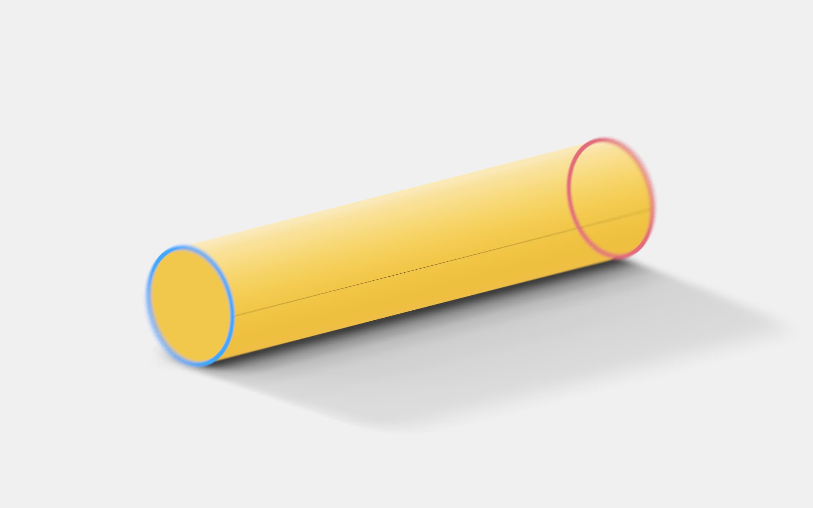
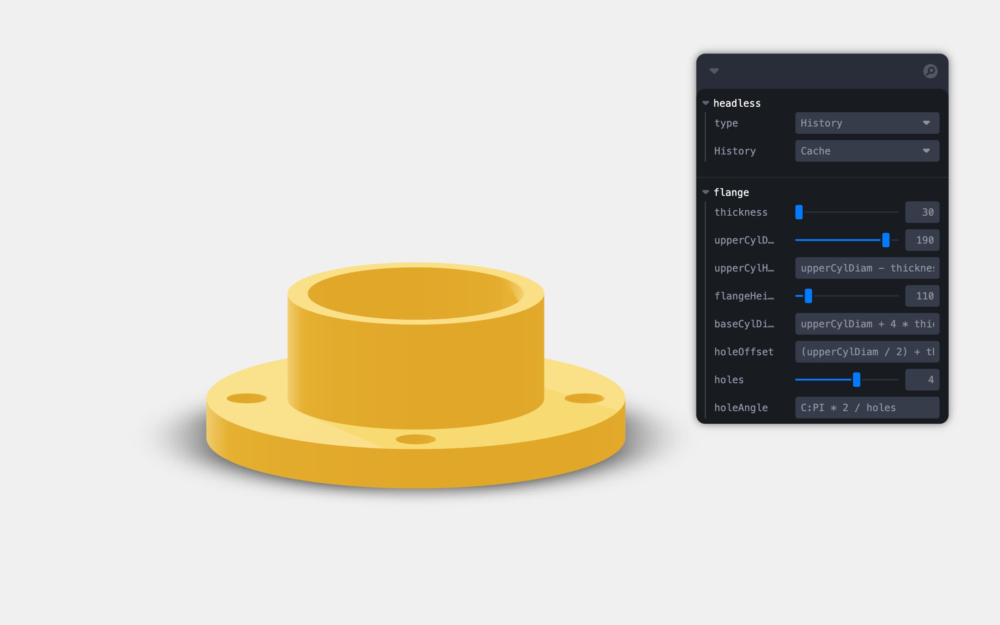
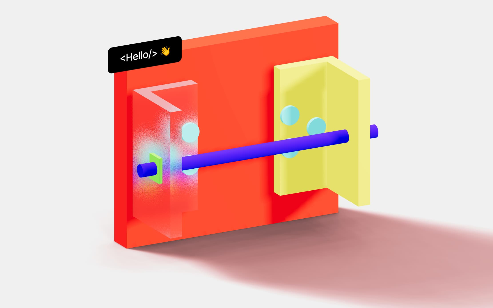
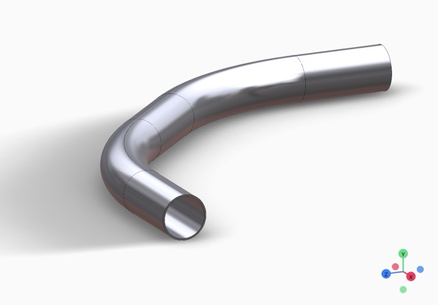
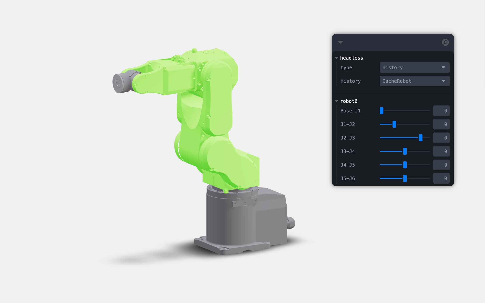
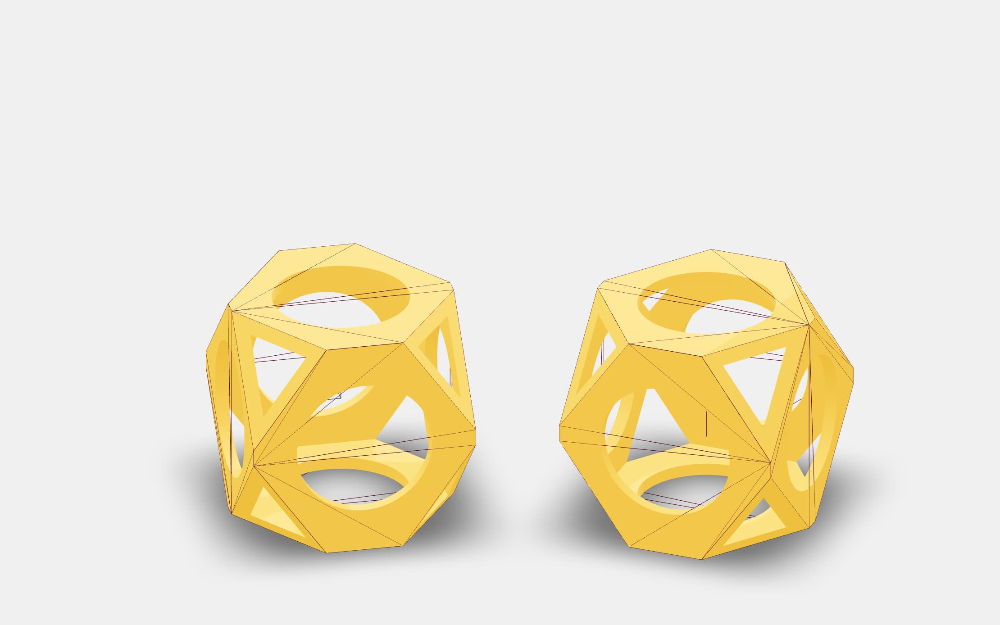
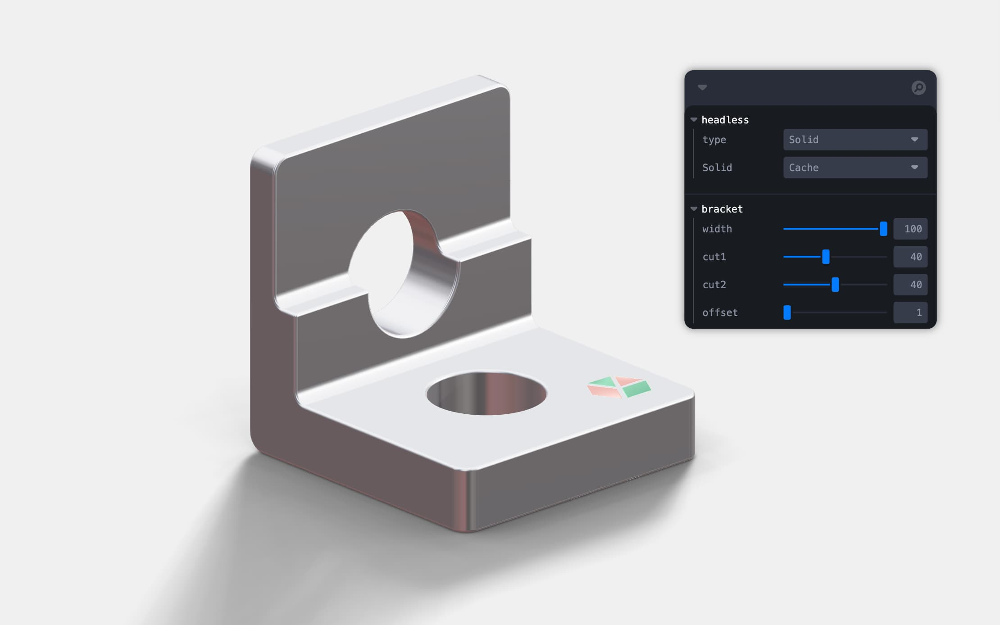

# buerli-starter

A collection of self-contained mini examples showing various features of Buerli, and how to employ them in a React context.

First, clone the repository.

```shell
git clone https://github.com/awv-informatik/buerli-starter
cd buerli-starter
yarn
```

### Connect to ClassCAD

**buerli-starter** needs the ClassCAD engine. It runs in your browser as WebAssembly, or natively on your server. Say which in the `.env` file in the root of this project.

### Running ClassCAD in the browser (WebAssembly)

1. Sign up on [classcad.ch/account](https://classcad.ch/account).
2. Under **Access tokens** on [your account](https://classcad.ch/account#tokens), make a public access token. It starts with `ccpk_`.
3. Put it into `.env`:

```shell
CLASSCAD_PUBLIC_TOKEN=ccpk_…
```

The token is public: it belongs in a page's code, and works on `localhost` and on the domains you register under **Domains** on your account. See [Quickstart with WebAssembly](https://buerli.io/docs/quickstart/wasm).

> The first time ClassCAD starts in the browser, loading may take some time depending on your internet speed.

### Running ClassCAD natively

The native engine (Business plan) runs on your server. Download it, give it its secret access token (`ccsk_…`, it never goes into a page) and start one of its two servers, as described in [Quickstart with a native engine](https://buerli.io/docs/quickstart/native). Then leave `CLASSCAD_PUBLIC_TOKEN` empty in `.env` and set the address of the server you started:

```shell
# classcad-cli worker, through WSClient
WS_URL=ws://localhost:9094
```

```shell
# classcad-socketio, through SocketIOClient
SOCKETIO_URL=ws://localhost:9091
```

### Run the examples

```shell
yarn dev
```

All examples inside `/packages` are self contained and can be ran and forked individually! Put your public access token into `token` in each example's `src/main.jsx` in that case.

## Starters

<p>
  <a href="https://github.com/awv-informatik/buerli-starter/tree/main/packages/with-part-run"></a>
  <a href="https://github.com/awv-informatik/buerli-starter/tree/main/packages/with-part-cache"></a>
  <a href="https://github.com/awv-informatik/buerli-starter/tree/main/packages/with-assembly-cache-as1ac214-jsx"></a>
  <a href="https://github.com/awv-informatik/buerli-starter/tree/main/packages/with-assembly-pipes"></a>
  <a href="https://github.com/awv-informatik/buerli-starter/tree/main/packages/with-assembly-cache-robot"></a>
  <a href="https://github.com/awv-informatik/buerli-starter/tree/main/packages/with-solid-cache"></a>
  <a href="https://github.com/awv-informatik/buerli-starter/tree/main/packages/with-solid-cache-reuse"></a>
  <a href="https://github.com/awv-informatik/buerli-starter/tree/main/packages/with-stepviewer"></a>
</p>

### Links to our homepages and documentations

- [buerligons.io](https://buerligons.io)
- [buerli.io](https://buerli.io)
- [classcad.ch](https://classcad.ch)
- [awv-informatik.ch](https://awv-informatik.ch)