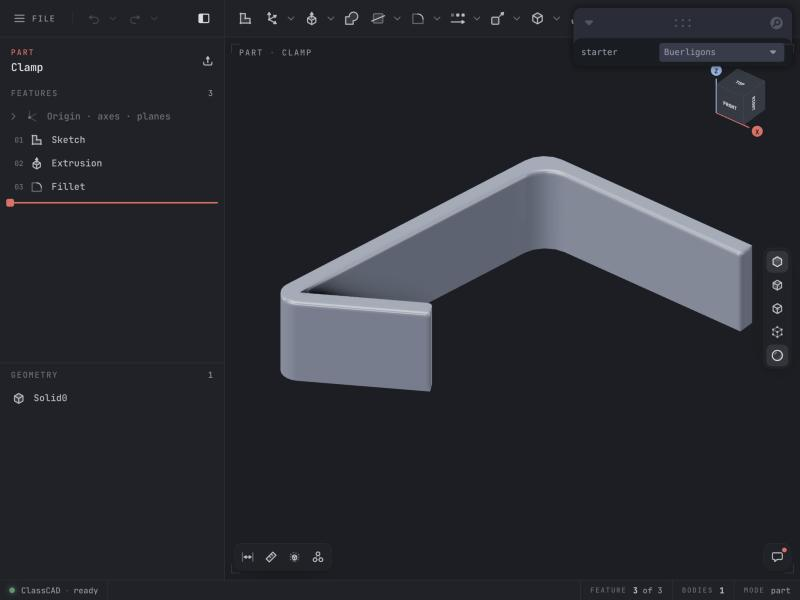

<br />

```shell
git clone https://github.com/awv-informatik/buerli-starter
cd buerli-starter/packages/with-buerligons
npm install
npm run dev
```

Before `npm run dev`, put your public access token (`ccpk_…`, from [your ClassCAD account](https://classcad.ch/account#tokens)) into `token` in `src/main.jsx`, see [Quickstart with WebAssembly](https://buerli.io/docs/quickstart/wasm).

The smallest Buerligons app: the whole CAD editor as one component, `<Buerligons />` from [@buerli.io/buerligons](https://www.npmjs.com/package/@buerli.io/buerligons). An `EditorController` loads a part (`Clamp.ofb`) into it, which you can then edit: its sketches, features and parameters.

### References

- [Buerligons](https://buerligons.io)
- [@buerli.io/buerligons](https://www.npmjs.com/package/@buerli.io/buerligons)
